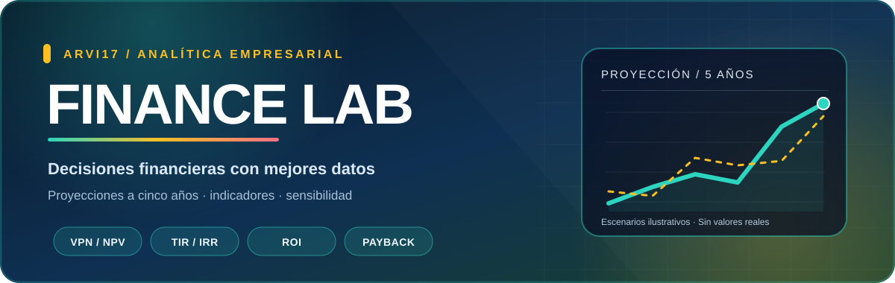

# 📊 Evaluador de Viabilidad Financiera

### Proyecciones, indicadores y escenarios para decisiones de negocio

**Un tablero interactivo para analizar la viabilidad financiera de un proyecto a cinco años.**

[**Abrir el archivo de la aplicación**](Herramienta%20de%20viabilidad%20financiera%20vers4.0.html)

---

## ✨ Qué puedes analizar

| Área | Funcionalidades |
| --- | --- |
| 💼 Inversión y operación | Inversión inicial, costos, ventas y crecimiento proyectado. |
| 💸 Flujos financieros | Flujo de caja y resultados estimados para cinco años. |
| 📈 Evaluación de proyectos | VPN, TIR, ROI y período de recuperación (*payback*). |
| 🧪 Escenarios | Análisis de sensibilidad para comparar supuestos. |
| 📑 Presentación | Tablas de resultados y opciones de exportación a Excel/CSV y PDF. |

## 🚀 Uso rápido

1. Descarga o clona este repositorio.
2. Abre `Herramienta de viabilidad financiera vers4.0.html` en un navegador moderno.
3. Registra la información del proyecto: inversión, productos o servicios, costos y proyecciones.
4. Ejecuta el análisis y revisa los indicadores, flujos y escenarios.
5. Exporta los resultados mediante las opciones de la propia aplicación.

> **Importante:** La calidad de las conclusiones depende de los datos y supuestos ingresados. Esta herramienta apoya el análisis; no reemplaza la validación contable, financiera o profesional de una inversión.

## 🧰 Tecnología

Aplicación web concentrada en un archivo **HTML**, con interfaz en **CSS** y lógica de cálculo en **JavaScript**. El repositorio está pensado para explorar la herramienta y su implementación.

## 🔗 Explora más proyectos

- [⚽ Asistente local FC / DCP](https://github.com/ARVI17/emuladordcp26)
- [🏫 Asistente Institucional Palominito](https://github.com/ARVI17/Asistente_Palominito_v4_Conversacional)
- [🤖 Modelo de predicción de fútbol con ML](https://github.com/ARVI17/Modelo-de-Machine-Learning-para-predecir-el-resultado-de-un-partido-de-f-tbol-win-draw-loss-)

---

Proyecto de <a href="https://github.com/ARVI17">ARVI17</a> · Documentación en español

